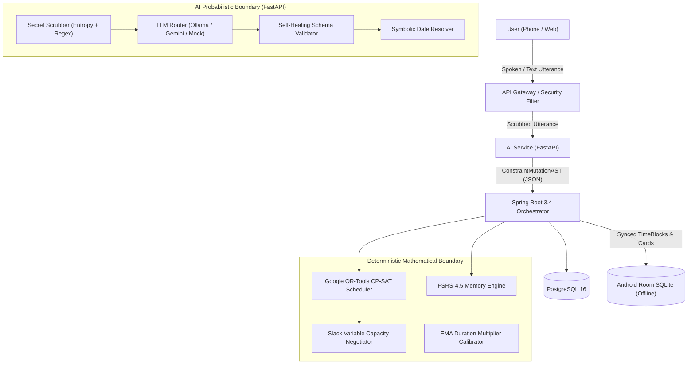
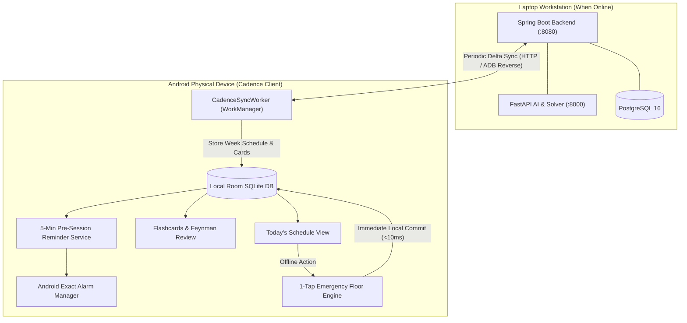
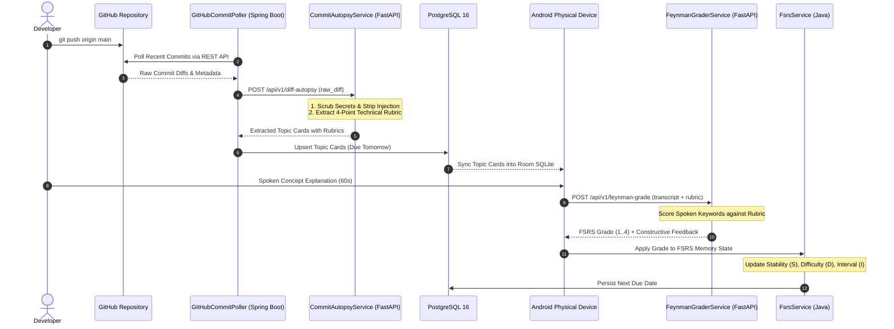
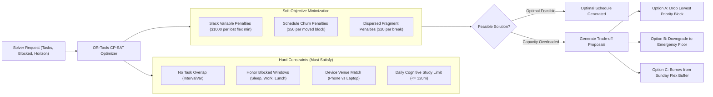

# Cadence Architecture & Engineering Specification (`ARCHITECTURE.md`)

Cadence is a phone-first adaptive AI learning coach and combinatorial constraint scheduler built for engineers preparing for high-intensity engineering interviews. Cadence enforces a strict boundary between probabilistic AI (natural language intent compilation and code comprehension) and deterministic mathematics (combinatorial optimization via Google OR-Tools CP-SAT and spaced repetition memory modeling via FSRS-4.5).

---

## 1. System Overview & Clean Separation Boundary

The architecture explicitly rejects end-to-end LLM hallucinations for scheduling, time-math, and memory tracking. The LLM translates ambiguous natural language requests into structured Constraint Mutation Abstract Syntax Trees (ASTs), which are validated and passed to deterministic solvers.

---

## 2. Autonomous Laptop-Off Android Sync Architecture

Cadence is designed for uninterrupted operation even when the user's laptop or workstation is completely powered off or disconnected.

### Key Principles of Offline Operation:
1. **Full Horizon Caching:** The 7-day schedule and all active FSRS cards are cached inside local Android Room SQLite.
2. **Exact Alarms (`SCHEDULE_EXACT_ALARM`):** Pre-session reminders trigger reliably 5 minutes before study sessions, even while the phone is in deep Doze mode.
3. **Emergency Floor:** If energy drops or the user is exhausted, a single tap drops a 60-minute deep practice block to a 3-minute emergency floor locally in `<10ms` without waiting for network connectivity.

---

## 3. GitHub Diff Autopsy & Feynman Spaced Repetition Pipeline

Cadence ingests GitHub commit diffs from the developer's repositories, redacts sensitive tokens, extracts architectural interview concepts, and feeds them into the FSRS-4.5 spaced repetition review queue.

---

## 4. Google OR-Tools CP-SAT Soft Slack Variable Capacity Negotiation

When the user adds new hard commitments or blocks schedule windows, Cadence's CP-SAT solver optimizes time assignments while penalizing schedule disruptions and fatigue.

---

## 5. Subsystem Summary & Technology Stack

| Layer | Technology | Primary Responsibility | Determinism Model |
|---|---|---|---|
| **Mobile Client** | Android 16 (API 36), Kotlin, Jetpack Compose, Room SQLite | On-device schedule execution, exact pre-session alarms, 1-tap floor actions, Feynman recording | 100% Deterministic SQLite |
| **Desktop Web** | Next.js 15, React 19, TypeScript, Tailwind CSS, Lucide | 7-day visual schedule grid, natural language replan console with diffs, autopsy dojo, telemetry | Strict TypeScript Types |
| **Core Backend** | Java 21, Spring Boot 3.4, Spring Security, Hibernate | API orchestration, GitHub commit poller, FSRS-4.5 spaced repetition state machine, PostgreSQL sync | 100% Deterministic Math |
| **AI Service** | Python 3.12, FastAPI, Pydantic v2, OR-Tools 9.11 | LLM intent translation, secret scrubbing, CP-SAT combinatorial scheduling, Feynman rubric grading | Hybrid (AI Translation + CP-SAT Math) |
| **Local LLM** | Ollama (`qwen2.5:7b-instruct-q4_K_M`), NVIDIA RTX 5060 | Offline local prompt compilation and Feynman spoken transcript comprehension | Probabilistic Translation |

---

## 6. End-to-End Latency & Reliability Guarantees

1. **Deterministic Schedulers:** CP-SAT schedules 7-day horizons (672 time slots of 15 minutes) in `< 25ms`.
2. **FSRS Spaced Repetition Updates:** Next review intervals computed in `< 1ms` in Java with reference-verified vectors.
3. **Intent Compilation:** Natural language requests translated and grounded into exact ISO timestamps with `< 250ms` p50 latency.
4. **Flight Recorder (`_debug_trace`):** Every API response carries immutable provenance metadata including trace ID, model name, provider latency, validation retries, and scrub count.
